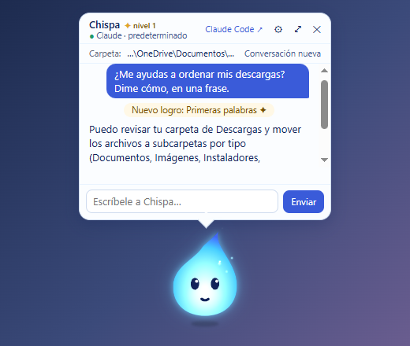

# Wispkin

[English](README.md) · **Español**

**Tu asistente de IA, con cara y en tu escritorio.**

Wispkin es una app para Windows que pone a tu asistente de IA en el escritorio. **Chispa**, un pequeño fuego fatuo azul, flota sobre tus ventanas, reacciona a lo que hace la IA (pensar, trabajar, pedir permiso, terminar) y, al darle clic, abre un globo para conversar.

- **Funciona con Claude**, con tu propia clave de API de Anthropic: el asistente puede leer y editar archivos y ejecutar comandos en tu equipo, **siempre pidiéndote permiso antes**. Pagas solo tu uso, directamente a Anthropic, y Wispkin te muestra lo que llevas gastado hoy, con un tope diario opcional.
- **Funciona con Ollama**: modelos que corren en tu PC, gratis y sin que la conversación salga de tu equipo. En esta versión solo conversa.
- **Chispa crece contigo**: energía, humor, niveles y variantes desbloqueables. Nunca enferma ni te culpa por no usarlo, y se puede apagar.
- **Abre en Claude Code** la misma conversación, e importa **Codex Pets** y **Shimeji**.
- **Privado**: sin cuentas, sin telemetría, sin publicidad.

> 🧪 **Beta.** Wispkin está en beta: puede tener fallos. Usa una carpeta de prueba o un proyecto con copia de seguridad cuando le pidas trabajar con archivos.



## Descarga

Descarga el instalador `Wispkin-Setup-<versión>.exe` desde **[Releases](../../releases/latest)**. Wispkin se actualiza solo cuando hay una versión nueva.

Muy pronto también en Microsoft Store.

### Aviso de Windows SmartScreen

El instalador todavía no está firmado con un certificado de pago, así que Windows puede mostrar **"Windows protegió tu PC"**. Para continuar: **Más información → Ejecutar de todas formas**.

Si prefieres comprobar el archivo, compara su SHA-256 con el que aparece en las notas de la versión:

```powershell
Get-FileHash .\Wispkin-Setup-<versión>.exe
```

## Requisitos

- Windows 10 (1809 o posterior) u 11, 64 bits.
- **Para Claude:** una cuenta de Anthropic con clave de API (de pago, por uso). Recomendamos una clave solo para Wispkin, con límite de gasto.
- **Para Ollama:** [Ollama](https://ollama.com/download) instalado y un modelo descargado (por ejemplo `ollama pull llama3.2`). Para modelos útiles, una GPU con 6–8 GB de VRAM o más; sin GPU funciona, pero lento.
- **Opcional:** Claude Code, para "Abrir en Claude Code".

## Primeros pasos

1. Instala y abre Wispkin. Chispa aparece en tu escritorio y un icono en la bandeja.
2. Haz clic en Chispa y elige tu cerebro: **Claude** (pega tu clave) u **Ollama** (elige un modelo).
3. Escríbele. Cuando quiera tocar algo en tu equipo, te pedirá permiso.

Atajo: **Ctrl+Alt+P** abre y cierra el globo. La bandeja tiene *No molestar*, el cambio de avatar e *Importar avatar…*.

## Privacidad y términos

- Todo se guarda en tu equipo (`%APPDATA%\wispkin`); tus claves, cifradas con el cifrado de Windows.
- Tus conversaciones van directamente de tu equipo al proveedor que elegiste, con tu clave. Wispkin no tiene servidores que las reciban.
- Sin telemetría ni analítica. Para buscar actualizaciones, la app consulta este repositorio en GitHub.

Lee la [política de privacidad](PRIVACIDAD.md) y los [términos de uso](TERMINOS.md).

## Reportar un fallo o dar tu opinión

- **Fallos:** abre un [issue](../../issues/new) con la plantilla. Los issues son públicos: **nunca pegues tu clave** ni información privada.
- **Opinión:** [formulario de opinión](https://forms.gle/bBhzJXpousYvmrnL9) (2 minutos).
- **Seguridad** (por ejemplo, algo que exponga tu clave o una acción sin permiso): no abras un issue público; escribe a wispkin.app@gmail.com.

## Sobre este repositorio

Aquí solo se publican los instaladores, las notas de versión y el canal de actualizaciones de Wispkin. El código fuente no es público por ahora.

---

Wispkin es un proyecto independiente. **No está afiliado, patrocinado ni respaldado por Anthropic, OpenAI, Ollama ni Microsoft.** Claude es una marca de Anthropic; Codex, de OpenAI; Ollama, de sus titulares. Se mencionan solo para indicar compatibilidad.

© 2026 Wisplight Studio
